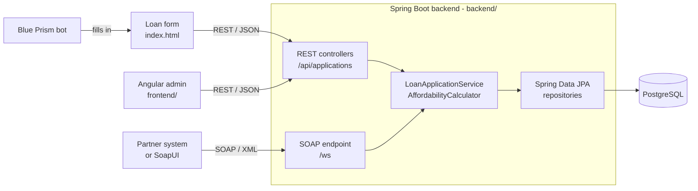

# SNM Bank – Loan Application System

A loan application system for **SNM Bank**, a fictional bank.

It started as a two-page web form, and I'm now adding a **Java backend**, a **SOAP interface for partner systems** and an **Angular admin screen** for staff who review applications.

> **Status:** 🚧 In progress. See the [roadmap](#roadmap) for what's done and what's next.

**Live form:** https://sibu912.github.io/SNM-Bank-loan-application/

---

## What it does

| Who | What they do |
|-----|--------------|
| **Applicant** | Fills in the form: personal details, then loan details |
| **Backend** | Saves the application, runs an affordability check and returns a reference number such as `SNM-2026-000001` |
| **Reviewer** (Angular admin) | Lists applications and moves them through `SUBMITTED → UNDER_REVIEW → APPROVED / DECLINED` |
| **Partner system** (SOAP) | Submits applications and checks their status using an XML contract (XSD) |
| **Blue Prism bot** | Fills in the form automatically (an RPA exercise that uses the same page) |

## Architecture



## Tech stack

| Area | Technology |
|------|------------|
| Backend | Java 21, Spring Boot, Spring Web, Spring Web Services (SOAP), Bean Validation |
| Data | Spring Data JPA / Hibernate, PostgreSQL 16, Flyway migrations, H2 for tests |
| Contracts | JSON over REST · XSD + JAXB for SOAP (contract-first) |
| Testing | JUnit 5, Mockito, MockMvc, Spring-WS test support |
| Frontend | HTML/CSS/JavaScript form (GitHub Pages) · Angular admin screen |
| CI | GitHub Actions |

## Repository layout

```text
SNM-Bank-loan-application/
├── index.html        # The loan form (served by GitHub Pages)
├── SNM Bank.png      # Logo
├── backend/          # Spring Boot service: REST + SOAP
├── frontend/         # Angular admin screen
└── docs/
    ├── DESIGN.md     # Requirements, business rules and design decisions
    ├── API.md        # REST endpoints and the SOAP contract (XSD)
    ├── DATABASE.md   # Entity-relationship diagram and table definitions
    └── SETUP.md      # How to run everything locally
```

## API at a glance

| Method | Path | Purpose |
|--------|------|---------|
| `POST` | `/api/applications` | Submit a new application |
| `GET` | `/api/applications?status=&page=&size=` | List applications (paged, optional status filter) |
| `GET` | `/api/applications/{referenceNumber}` | Get one application |
| `PATCH` | `/api/applications/{referenceNumber}/status` | Change status (reviewer) |
| `GET` | `/api/applications/{referenceNumber}/history` | Status change history |
| SOAP | `/ws` (WSDL: `/ws/loans.wsdl`) | `SubmitLoanApplication`, `GetApplicationStatus` |

Full details, with request and response examples, are in [docs/API.md](docs/API.md).

## Business rules (short version)

- **Affordability:** the estimated monthly repayment must be **30% or less** of the applicant's assessed monthly income. The calculation is in [docs/DESIGN.md](docs/DESIGN.md#6-business-rules).
- **Status flow:** `SUBMITTED → UNDER_REVIEW → APPROVED or DECLINED`. Only applications that passed the affordability check can be approved.
- **Audit trail:** every status change is saved in a history table.

## Running it locally

See [docs/SETUP.md](docs/SETUP.md). The short version:

```powershell
# 1. Create the database (once). Details are in SETUP.md.
# 2. Start the backend
cd backend
$env:DB_PASSWORD = "your-db-password"
.\mvnw.cmd spring-boot:run
```

## Roadmap

- [x] Loan form (HTML/CSS/JS) on GitHub Pages
- [x] Design docs: business rules, API, database
- [ ] Spring Boot project setup
- [ ] Database tables (Flyway), JPA entities and repositories
- [ ] Affordability check and status rules, with unit tests
- [ ] REST API with validation and error handling
- [ ] SOAP endpoint, built contract-first from an XSD
- [ ] Connect the form to the API
- [ ] Angular admin screen
- [ ] GitHub Actions build

**Later:** Oracle database profile · JMS message when a status changes · deployment to WebLogic · reviewer login

## What I learned

_I'm filling this in as I build each part._

## Author

**Sibusiso Mvula** · [GitHub](https://github.com/Sibu912)
