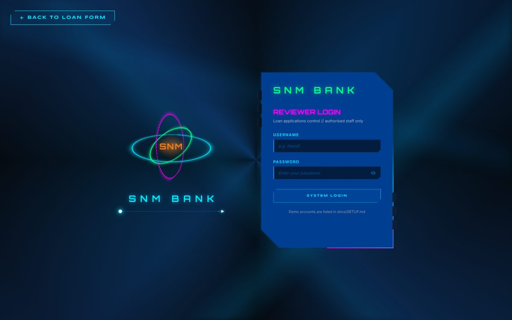
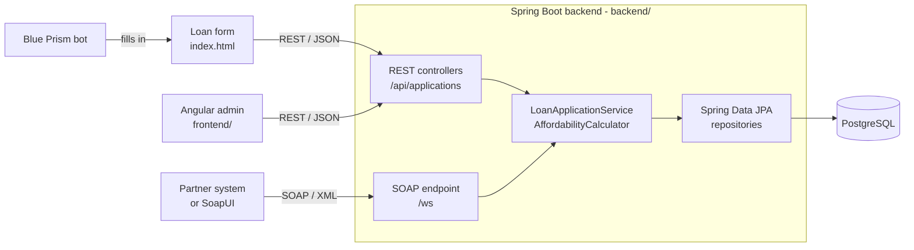
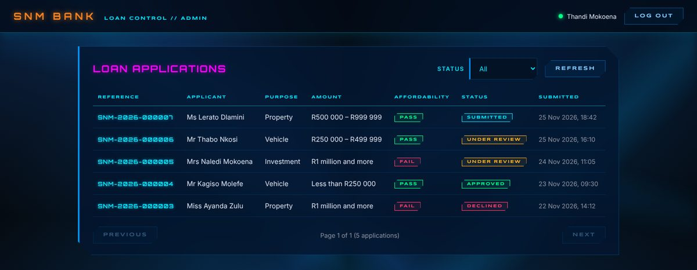
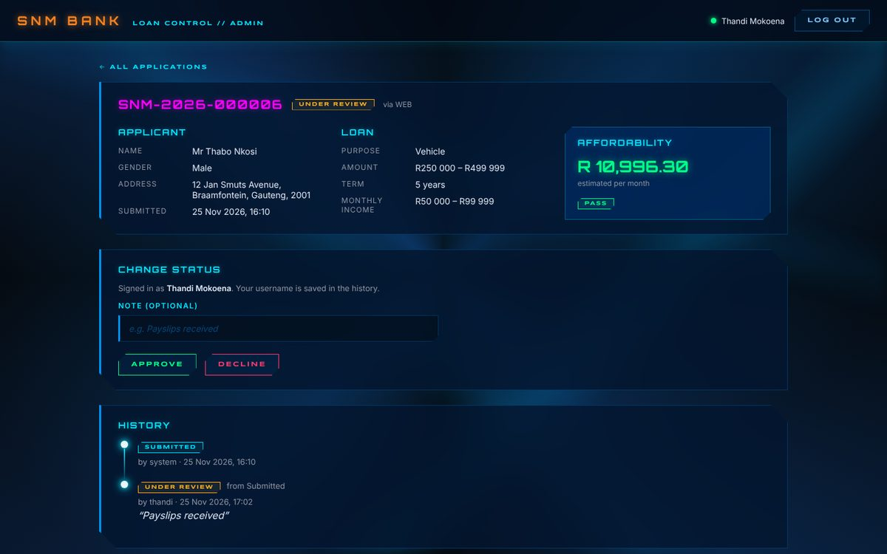

# SNM Bank – Loan Application System

[](https://github.com/Sibu912/SNM-Bank-loan-application/actions/workflows/ci.yml)

A loan application system for **SNM Bank**, a fictional bank.

It started as a two-page web form. It now has a **Java backend**, a **SOAP interface for partner systems** and an **Angular admin screen** for staff who review applications.

> **Status:** version 1 is complete. See the [roadmap](#roadmap) for ideas for later.

**Live form:** https://sibu912.github.io/SNM-Bank-loan-application/

---



## What it does

| Who | What they do |
|-----|--------------|
| **Applicant** | Fills in the form: personal details, then loan details |
| **Backend** | Saves the application, runs an affordability check and returns a reference number such as `SNM-2026-000001` |
| **Reviewer** (Angular admin) | Logs in, then lists applications and moves them through `SUBMITTED → UNDER_REVIEW → APPROVED / DECLINED` |
| **Partner system** (SOAP) | Submits applications and checks their status using an XML contract (XSD) |
| **Blue Prism bot** | Fills in the form automatically (an RPA exercise that uses the same page) |

## Architecture



## Tech stack

| Area | Technology |
|------|------------|
| Backend | Java 21, Spring Boot, Spring Web, Spring Web Services (SOAP), Bean Validation |
| Security | Spring Security: reviewer accounts in PostgreSQL (BCrypt), stateless JWT login |
| Data | Spring Data JPA / Hibernate, PostgreSQL 16 (a separate `snm_loans_test` database for tests), Flyway migrations |
| Contracts | JSON over REST · XSD + JAXB for SOAP (contract-first) |
| Testing | JUnit 5, Mockito, MockMvc, Spring-WS test support |
| Frontend | HTML/CSS/JavaScript form (GitHub Pages) · Angular admin screen with login (signals, route guard, HTTP interceptor) and a sci-fi theme |
| CI | GitHub Actions: builds and tests the backend and the frontend on every push |

## Repository layout

```text
SNM-Bank-loan-application/
├── index.html        # The loan form (served by GitHub Pages)
├── SNM Bank.png      # Logo
├── backend/          # Spring Boot service: REST + SOAP (see below)
├── frontend/         # Angular admin screen
└── docs/
    ├── DESIGN.md     # Requirements, business rules and design decisions
    ├── API.md        # REST endpoints and the SOAP contract (XSD)
    ├── DATABASE.md   # Entity-relationship diagram and table definitions
    └── SETUP.md      # How to run everything locally
```

## API at a glance

| Method | Path | Purpose |
|--------|------|---------|
| `POST` | `/api/auth/login` | Reviewer login, returns a JWT |
| `POST` | `/api/applications` | Submit a new application (public) |
| `GET` | `/api/applications?status=&page=&size=` | List applications (paged, optional status filter) |
| `GET` | `/api/applications/{referenceNumber}` | Get one application |
| `PATCH` | `/api/applications/{referenceNumber}/status` | Change status (reviewer) |
| `GET` | `/api/applications/{referenceNumber}/history` | Status change history |
| SOAP | `/ws` (WSDL: `/ws/loans.wsdl`) | `SubmitLoanApplication`, `GetApplicationStatus` |

All `GET` and `PATCH` endpoints need a login (`Authorization: Bearer <token>`). Full details, with request and response examples, are in [docs/API.md](docs/API.md).

## Business rules (short version)

- **Affordability:** the estimated monthly repayment must be **30% or less** of the applicant's assessed monthly income. The calculation is in [docs/DESIGN.md](docs/DESIGN.md#6-business-rules).
- **Status flow:** `SUBMITTED → UNDER_REVIEW → APPROVED or DECLINED`. Only applications that passed the affordability check can be approved.
- **Audit trail:** every status change is saved in a history table.

## Backend structure

```text
backend/src/main/java/io/github/sibu912/snmbank/loans/
├── domain/        JPA entities (Applicant, LoanApplication, ApplicationStatusHistory) and enums
├── repository/    Spring Data JPA interfaces
├── service/       LoanApplicationService, AffordabilityCalculator - the business rules
├── web/           REST controllers (applications + login), DTOs (records), validation, ProblemDetail errors
├── security/      Reviewer accounts for Spring Security, JWT creation
├── soap/          Spring-WS config, endpoint and mapper (JAXB classes are generated from the XSD)
└── config/        Security rules, password checking, settings (snm.loan.*) and CORS
backend/src/main/resources/
├── application.yml
├── db/migration/V1__create_loan_tables.sql     (Flyway)
├── db/migration/V2__create_reviewer_table.sql  (reviewer accounts + 2 demo users)
└── xsd/loan-application.xsd                  (SOAP contract)
```

## Tests

| Where | What | How many |
|-------|------|----------|
| `backend` | Unit tests: affordability maths, status rules, service with Mockito mocks | 26 |
| `backend` | Web layer: every endpoint, validation errors, security rules, CORS (`@WebMvcTest` + MockMvc) | 15 |
| `backend` | Database: Flyway + JPA mappings + repositories on PostgreSQL (`@DataJpaTest`) | 6 |
| `backend` | End to end: login and tokens, REST flow, SOAP via `MockWebServiceClient`, SOAP and WSDL over real HTTP | 18 |
| `frontend` | Login, auth service, token interceptor, route guard, API service and pages (Vitest) | 31 |

Run them with `.\mvnw.cmd verify` in `backend` and `npm test -- --watch=false` in `frontend`.

## Screenshots

| Applications | One application |
|---|---|
|  |  |

## Running it locally

See [docs/SETUP.md](docs/SETUP.md). The short version:

```powershell
# 1. Create the database (once). Details are in SETUP.md.
# 2. Start the backend
cd backend
$env:DB_PASSWORD = "your-db-password"
.\mvnw.cmd spring-boot:run

# 3. In a second window, start the admin screen
cd frontend
npm install
npm start          # http://localhost:4200, log in as thandi / Reviewer#2026
```

## Running it online

The form and the admin run on GitHub Pages, the backend on Koyeb and the database on Neon, all on free plans. The step-by-step guide is in [docs/DEPLOY.md](docs/DEPLOY.md).

## Roadmap

- [x] Loan form (HTML/CSS/JS) on GitHub Pages
- [x] Design docs: business rules, API, database
- [x] Spring Boot project setup
- [x] Database tables (Flyway), JPA entities and repositories
- [x] Affordability check and status rules, with unit tests
- [x] REST API with validation and error handling
- [x] SOAP endpoint, built contract-first from an XSD
- [x] Connect the form to the API
- [x] Angular admin screen
- [x] GitHub Actions build
- [x] Reviewer login (Spring Security + JWT, accounts in PostgreSQL)
- [x] Tests run on PostgreSQL instead of H2

**Later:** Oracle database profile · JMS message when a status changes · deployment to WebLogic · reviewer roles

## What I learned

_I'm filling this in as I build each part._

## Author

**Sibusiso Mvula** · [GitHub](https://github.com/Sibu912)
