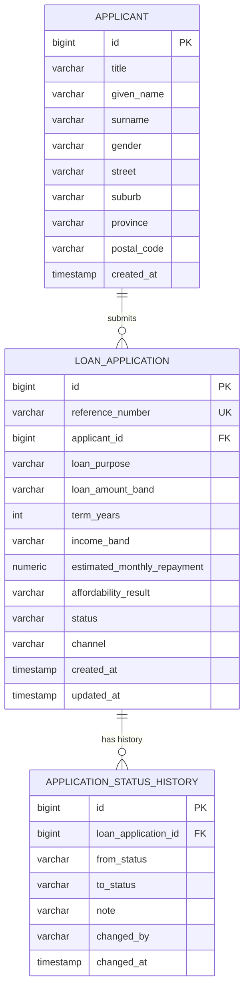

# Database – SNM Bank Loan Service

- **Database:** PostgreSQL 16: `snm_loans` for the app and `snm_loans_test` for the automated tests
- **Schema changes:** Flyway scripts in `backend/src/main/resources/db/migration/`
- **Hibernate:** `spring.jpa.hibernate.ddl-auto=validate`. Hibernate checks that the entities match the tables but never changes them.

---

## Entity-relationship diagram



## Tables

### `applicant`

The person applying: everything from page 1 of the form.
A new row is created for each submission, because the form doesn't collect an ID number (see [DESIGN.md D9](DESIGN.md#8-design-decisions)).

### `loan_application`

The loan request from page 2, plus what the system works out (`estimated_monthly_repayment`, `affordability_result`) and the current `status`.

- `reference_number` is `UNIQUE` and set straight after the insert ([DESIGN.md §6.4](DESIGN.md#64-reference-numbers))
- `channel` records where the application came from: `WEB` or `SOAP`
- `term_years` has a `CHECK` constraint, so the database rejects values the form doesn't offer, even if a bug gets past the Java validation

### `application_status_history`

One row per status change. It's **only ever added to**, never updated, so it's an audit trail: who changed what, and when.
The first row for each application has `from_status = NULL` and `to_status = SUBMITTED`.

## Indexes

| Index | Why |
|-------|-----|
| `idx_loan_application_status` | The admin screen filters by status |
| `idx_loan_application_applicant` | Joins from applicant to applications |
| `idx_status_history_application` | Loads one application's history |
| `reference_number` (unique) | Lookups by reference number. The `UNIQUE` constraint creates the index. |

## Migration V1

File: `backend/src/main/resources/db/migration/V1__create_loan_tables.sql`
(This script has been run against PostgreSQL 16. Its first comment still mentions H2, which the tests used at first. It isn't edited because Flyway would see a changed checksum.)

```sql
-- V1__create_loan_tables.sql
-- Creates the three tables for the SNM Bank loan service.
-- Written for PostgreSQL. Also runs on H2 (MODE=PostgreSQL) for tests.

CREATE TABLE applicant (
    id           BIGINT       GENERATED BY DEFAULT AS IDENTITY PRIMARY KEY,
    title        VARCHAR(10)  NOT NULL,
    given_name   VARCHAR(100) NOT NULL,
    surname      VARCHAR(100) NOT NULL,
    gender       VARCHAR(10)  NOT NULL,
    street       VARCHAR(150) NOT NULL,
    suburb       VARCHAR(100) NOT NULL,
    province     VARCHAR(50)  NOT NULL,
    postal_code  VARCHAR(4)   NOT NULL,
    created_at   TIMESTAMP    NOT NULL
);

CREATE TABLE loan_application (
    id                          BIGINT        GENERATED BY DEFAULT AS IDENTITY PRIMARY KEY,
    reference_number            VARCHAR(20)   UNIQUE,
    applicant_id                BIGINT        NOT NULL REFERENCES applicant (id),
    loan_purpose                VARCHAR(20)   NOT NULL,
    loan_amount_band            VARCHAR(30)   NOT NULL,
    term_years                  INTEGER       NOT NULL CHECK (term_years IN (5, 10, 15, 20, 25, 30)),
    income_band                 VARCHAR(30)   NOT NULL,
    estimated_monthly_repayment NUMERIC(12,2) NOT NULL,
    affordability_result        VARCHAR(10)   NOT NULL,
    status                      VARCHAR(20)   NOT NULL,
    channel                     VARCHAR(10)   NOT NULL,
    created_at                  TIMESTAMP     NOT NULL,
    updated_at                  TIMESTAMP     NOT NULL
);

CREATE INDEX idx_loan_application_status    ON loan_application (status);
CREATE INDEX idx_loan_application_applicant ON loan_application (applicant_id);

CREATE TABLE application_status_history (
    id                   BIGINT       GENERATED BY DEFAULT AS IDENTITY PRIMARY KEY,
    loan_application_id  BIGINT       NOT NULL REFERENCES loan_application (id),
    from_status          VARCHAR(20),
    to_status            VARCHAR(20)  NOT NULL,
    note                 VARCHAR(255),
    changed_by           VARCHAR(50)  NOT NULL,
    changed_at           TIMESTAMP    NOT NULL
);

CREATE INDEX idx_status_history_application ON application_status_history (loan_application_id);
```

> **Flyway rule:** once a migration has run anywhere, never edit it. Make a new file (`V2__...sql`) instead.

## JPA mapping notes

| Column type | Java type | Annotation |
|-------------|-----------|------------|
| `BIGINT ... IDENTITY` | `Long id` | `@Id @GeneratedValue(strategy = GenerationType.IDENTITY)` |
| enum codes (`VARCHAR`) | Java `enum` | `@Enumerated(EnumType.STRING)` |
| `NUMERIC(12,2)` | `BigDecimal` | `@Column(precision = 12, scale = 2)` |
| `TIMESTAMP` | `LocalDateTime` | set in `@PrePersist` / `@PreUpdate` |
| `applicant_id` | `Applicant applicant` | `@ManyToOne(fetch = FetchType.LAZY, optional = false)` |
| `loan_application_id` | `LoanApplication loanApplication` | `@ManyToOne(fetch = FetchType.LAZY, optional = false)` |

The history is read through its own repository (`findByLoanApplicationIdOrderByIdAsc`, which returns rows in the order they were inserted), not through a collection on the entity. That keeps the entities simple.

## Useful queries

```sql
-- How many applications are in each status?
SELECT status, COUNT(*) AS total
FROM loan_application
GROUP BY status
ORDER BY total DESC;

-- Affordability pass rate by loan amount band
SELECT loan_amount_band,
       COUNT(*) AS applications,
       ROUND(100.0 * SUM(CASE WHEN affordability_result = 'PASS' THEN 1 ELSE 0 END) / COUNT(*), 1) AS pass_rate_pct
FROM loan_application
GROUP BY loan_amount_band;

-- Full history for one application
SELECT h.changed_at, h.from_status, h.to_status, h.changed_by, h.note
FROM application_status_history h
JOIN loan_application la ON la.id = h.loan_application_id
WHERE la.reference_number = 'SNM-2026-000001'
ORDER BY h.changed_at;
```

## Oracle notes (later)

To run on Oracle, put a separate script in `db/migration-oracle/` and switch to it with a Spring profile. The main differences:

| PostgreSQL | Oracle |
|------------|--------|
| `BIGINT` | `NUMBER(19)` |
| `INTEGER` | `NUMBER(10)` |
| `VARCHAR(n)` | `VARCHAR2(n)` |
| `NUMERIC(12,2)` | `NUMBER(12,2)` |
| `GENERATED BY DEFAULT AS IDENTITY` | Same syntax (Oracle 12c and later) |
