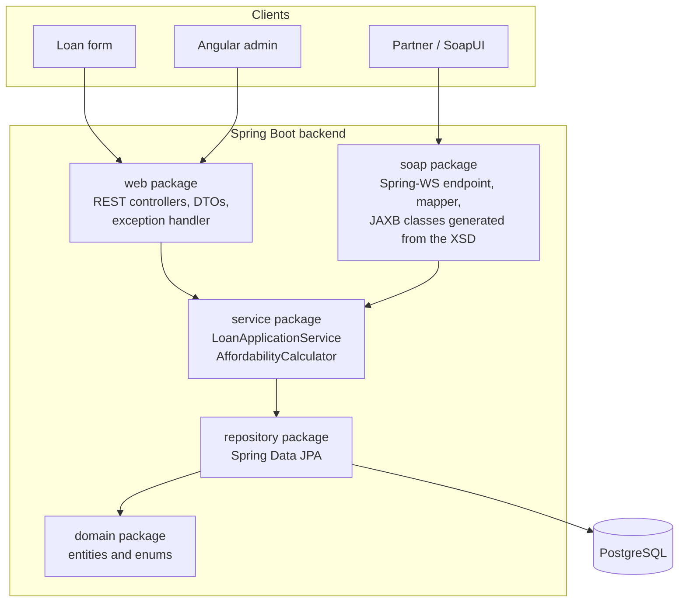
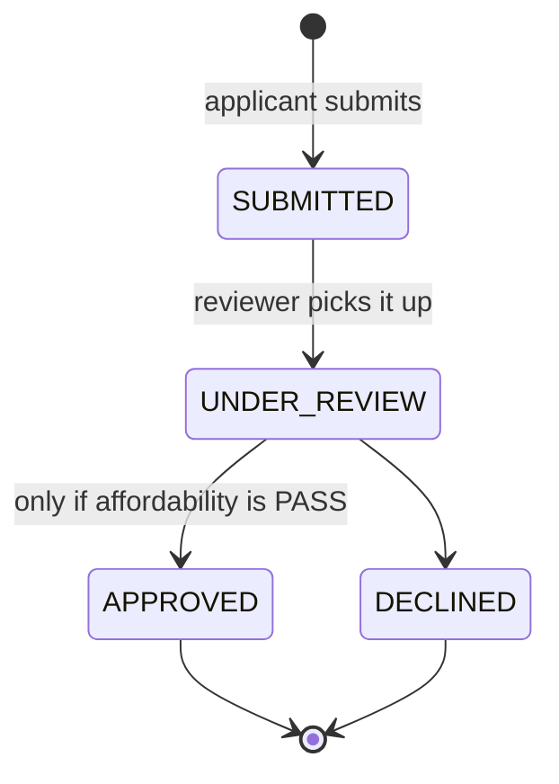

# Design – SNM Bank Loan Service

This document explains **what** the system does and **why** it's built this way.
The API details are in [API.md](API.md) and the tables are in [DATABASE.md](DATABASE.md).

---

## 1. Purpose

The loan form at `index.html` collects an applicant's details, but at the moment it doesn't save them anywhere.
The loan service adds:

1. A **backend** that stores applications and checks whether the loan is affordable
2. A **review process** so staff can approve or decline applications
3. A **SOAP interface** so other systems (for example, a broker's system) can submit applications

## 2. Scope (version 1)

| In scope | Out of scope (for now) |
|----------|------------------------|
| Save applications from the form (REST) | Login and roles for reviewers |
| Affordability check | Credit bureau checks |
| Status flow with history | Uploading documents |
| SOAP submit and status operations | Email or SMS notifications |
| Angular screen for reviewers | Deploying to the cloud |

## 3. Users and channels

| Actor | Channel | Notes |
|-------|---------|-------|
| Applicant | Web form → REST | The form calls the API only when it's given an API address (see decision D2) |
| Blue Prism bot | Web form | Fills in the same form. The element IDs in `index.html` must not change. |
| Reviewer | Angular admin → REST | Lists applications, changes their status, views history |
| Partner system | SOAP over HTTP | Uses the XSD contract in [API.md](API.md#soap-contract-xsd) |

## 4. Architecture



**Layers (package by layer):**

| Package | Responsibility | Talks to |
|---------|----------------|----------|
| `web` | HTTP and JSON: validation, status codes, error responses | `service` |
| `soap` | SOAP and XML: maps the generated JAXB classes to domain objects | `service` |
| `service` | Business rules and transactions | `repository` |
| `repository` | Database access (Spring Data interfaces) | database |
| `domain` | JPA entities and enums | nothing |

The REST and SOAP layers both call **the same service**, so the business rules live in one place.

Base Java package: `io.github.sibu912.snmbank.loans`

## 5. Domain model

### 5.1 Codes and how they map to the form

The form shows friendly labels. The API and database store **codes** (Java enums saved as text).

| Field | Form label | Code |
|-------|-----------|------|
| Title | Mr / Mrs / Miss / Ms | `MR` / `MRS` / `MISS` / `MS` |
| Gender | Male / Female | `MALE` / `FEMALE` |
| Loan purpose | Vehicle / Property / Investment | `VEHICLE` / `PROPERTY` / `INVESTMENT` |
| Loan amount | Less Than 250 000 | `LESS_THAN_250K` |
| | R250 000 - R499 999 | `FROM_250K_TO_499K` |
| | R500 000 - R999 999 | `FROM_500K_TO_999K` |
| | 1 Million and Greater | `ONE_MILLION_PLUS` |
| Loan length (years) | 5, 10, 15, 20, 25, 30 | the same numbers (`termYears`) |
| Income (gross per month) | Less then R50 000 | `LESS_THAN_50K` |
| | R50 000 - R99 999 | `FROM_50K_TO_99K` |
| | R100 000 - R149 999 | `FROM_100K_TO_149K` |
| | R150 000 or Greater | `FROM_150K_PLUS` |

> **Assumption:** the form doesn't say whether income is monthly or yearly. We treat it as **gross monthly income**.

### 5.2 Other enums

- `ApplicationStatus`: `SUBMITTED`, `UNDER_REVIEW`, `APPROVED`, `DECLINED`
- `AffordabilityResult`: `PASS`, `FAIL`
- `Channel`: `WEB` (form or Angular), `SOAP` (partner)

## 6. Business rules

### 6.1 Validation

| Field | Rule |
|-------|------|
| All fields | Required |
| `givenName`, `surname` | 1–100 characters |
| `street` | 1–150 characters |
| `suburb` | 1–100 characters |
| `province` | 1–50 characters |
| `postalCode` | Exactly 4 digits (South African postal codes) |
| `termYears` | One of 5, 10, 15, 20, 25, 30 |
| Enum fields | Must be one of the codes in 5.1 |

REST uses Bean Validation (`@NotNull`, `@Size`, `@Pattern`). SOAP requests are checked against the XSD before they reach the endpoint.

### 6.2 Affordability check

The form collects **bands**, not exact amounts, so each band has a fixed **assessment value**:

| Loan amount band | Amount used |
|------------------|-------------|
| `LESS_THAN_250K` | R250 000 |
| `FROM_250K_TO_499K` | R500 000 |
| `FROM_500K_TO_999K` | R1 000 000 |
| `ONE_MILLION_PLUS` | R1 500 000 |

| Income band | Monthly income used |
|-------------|---------------------|
| `LESS_THAN_50K` | R25 000 |
| `FROM_50K_TO_99K` | R50 000 |
| `FROM_100K_TO_149K` | R100 000 |
| `FROM_150K_PLUS` | R150 000 |

We use the **top** of each loan band and the **bottom** of each income band. This is deliberately cautious: it assumes the most the person might borrow and the least they might earn.

**Monthly repayment** uses the standard amortisation formula:

```text
M = P × r × (1 + r)^n / ((1 + r)^n − 1)

P = loan amount used (see table above)
r = annual interest rate / 12
n = term in years × 12
```

- The annual interest rate is a **setting**: `snm.loan.annual-interest-rate=0.115` (11.5%). It's an example rate for this project, not a real bank rate.
- The result is a `BigDecimal` rounded to 2 decimal places (`HALF_UP`).

**Rule:** `PASS` if `M ≤ 30% × monthly income used`, otherwise `FAIL`. The 30% limit is also a setting: `snm.loan.max-repayment-to-income=0.30`.

**Test cases** (11.5% interest, 30% limit). These numbers were checked with a separate calculation:

| Loan band | Years | Income band | Repayment M | Limit (30%) | Result |
|-----------|-------|-------------|-------------|-------------|--------|
| `FROM_250K_TO_499K` | 5 | `FROM_50K_TO_99K` | R10 996.30 | R15 000.00 | PASS |
| `FROM_500K_TO_999K` | 5 | `FROM_50K_TO_99K` | R21 992.61 | R15 000.00 | **FAIL** |
| `FROM_500K_TO_999K` | 10 | `FROM_50K_TO_99K` | R14 059.54 | R15 000.00 | PASS |
| `ONE_MILLION_PLUS` | 20 | `LESS_THAN_50K` | R15 996.44 | R7 500.00 | **FAIL** |
| `ONE_MILLION_PLUS` | 30 | `FROM_50K_TO_99K` | R14 854.37 | R15 000.00 | PASS (close to the limit) |
| `LESS_THAN_250K` | 10 | `LESS_THAN_50K` | R3 514.89 | R7 500.00 | PASS |

A failed affordability check **does not reject the application automatically**. It's saved with `affordabilityResult = FAIL`, and the reviewer can't approve it (see 6.3).

### 6.3 Status flow



| From | Allowed next status |
|------|---------------------|
| `SUBMITTED` | `UNDER_REVIEW` |
| `UNDER_REVIEW` | `APPROVED`, `DECLINED` |
| `APPROVED` | none (final) |
| `DECLINED` | none (final) |

Rules:

1. Any other change is rejected: REST returns **409 Conflict**, with an error body that explains why.
2. `APPROVED` is only allowed when `affordabilityResult = PASS`. The Angular admin also disables its Approve button in that case.
3. Every change, including the first `SUBMITTED`, **adds a row** to `application_status_history` with the old status, new status, note, who made the change and when.
4. The allowed moves are defined in one place: a method on the enum, `ApplicationStatus.canMoveTo(next)`.

### 6.4 Reference numbers

Format: `SNM-<year>-<6-digit id>`, for example `SNM-2026-000001`.

The number is built from the database ID, so it's set **straight after the insert, in the same transaction**: save → read the generated ID → set the reference. The column is `UNIQUE`.

## 7. Error handling

| Situation | REST | SOAP |
|-----------|------|------|
| Invalid input | 400 + list of field errors | SOAP Fault (XSD validation) |
| Reference number not found | 404 | SOAP Fault: `Client`, "Application … not found" |
| Status change not allowed | 409 | n/a (no status changes over SOAP in v1) |
| Unexpected error | 500 with a generic message. Details go to the log only. | SOAP Fault: `Server` |

REST errors use Spring's `ProblemDetail` format (RFC 9457). There are examples in [API.md](API.md#error-format).

## 8. Design decisions

| # | Decision | Why |
|---|----------|-----|
| D1 | Backend and frontend live in the **same repo** as the form (`backend/`, `frontend/`) | The whole story is in one place. GitHub Pages still serves `index.html` from the root. |
| D2 | The form calls the API **only when the page URL has `?api=...`** | The public GitHub Pages form and the Blue Prism bot keep working exactly as before. To test locally, use `index.html?api=http://localhost:8080`. |
| D3 | Don't rename any element IDs in `index.html` | The Blue Prism bot finds fields by their IDs. |
| D4 | PostgreSQL for development, H2 for tests, **Flyway** for the schema, Hibernate in `validate` mode | The schema is versioned SQL that can be reviewed. Hibernate only checks the tables; it never changes them. |
| D5 | **Contract-first SOAP**: write the XSD first, then generate the Java classes with JAXB | Partners agree on the XML contract before any code is written, which is how enterprise integrations usually work. |
| D6 | Enums stored as text (`EnumType.STRING`) | Easy to read in the database, and adding a new value doesn't break existing data. |
| D7 | `BigDecimal` for money | `double` causes rounding errors with currency. |
| D8 | No login in v1. The reviewer's name is sent as `changedBy`. | Keeps v1 small. Spring Security is on the roadmap. |
| D9 | No ID number is collected, so a new `applicant` row is created for every submission | The form doesn't ask for an ID number, and we only store what we need (in the spirit of POPIA). |
| D10 | Package by layer (`web`, `service`, `repository`, …) | Easy to follow at this size. |

## 9. Later ideas

- **Oracle profile:** run the same app against Oracle Database Free (Docker), with an Oracle-specific Flyway folder
- **JMS:** publish an `ApplicationStatusChanged` message to a queue (ActiveMQ Artemis, which uses the same JMS API as TIBCO EMS)
- **WebLogic:** package the backend as a WAR and deploy it to WebLogic in Docker
- **Security:** reviewer login with Spring Security
